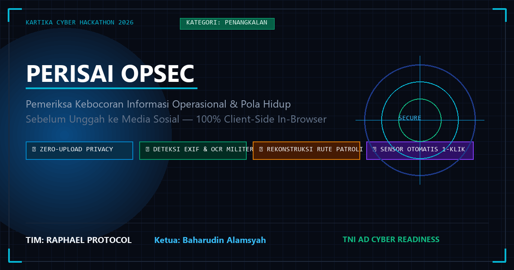

# PERISAI OPSEC

> **Periksa sebelum unggah.** Aplikasi web pemeriksa kebocoran informasi operasional (OPSEC) foto, metadata EXIF/GPS, teks citra (OCR), dan rekonstruksi pola hidup — berjalan **100% di browser tanpa mengirim data ke server**.

[](https://perisai-opsec.vercel.app)
[](./LICENSE)
[](./docs/05_QA_TEST_PLAN.md)
[](./package.json)



Proyek ini dibuat untuk **Kartika Cyber Hackathon 2026** (Kategori: **Penangkalan**) oleh **Tim Raphael Protocol**.

---

## 🌐 Live Demo & Cara Mencoba

- **URL Publik (Tanpa Login):** [https://perisai-opsec.vercel.app](https://perisai-opsec.vercel.app)
- **Mode Demo Instan (Data Fiktif):**
  1. Buka halaman **Analisis**, lalu klik **"Coba foto contoh"** untuk memuat 5 skenario sintetis (foto bersih, GPS saja, papan satuan/NRP fiktif, dokumen `RAHASIA` fiktif, plat dinas contoh).
  2. Buka halaman **Pola Hidup**, lalu klik **"Muat contoh pola hidup"** (atau **"Unggah foto sendiri"**) untuk melihat rekonstruksi rute & jadwal rutin dari 8 foto GPS sintetis.
  3. Klik **"Buat versi aman"** untuk mengunduh salinan foto yang sudah bersih dari metadata EXIF dan tersensor otomatis.

---

## ✨ Fitur Utama

- **Ekstraksi Metadata EXIF & GPS:** Membaca koordinat lokasi, waktu pengambilan, dan tipe perangkat secara lokal tanpa mengunggah file.
- **OCR Luring (WebAssembly):** Mengenali teks bahasa Indonesia dan Inggris di dalam foto menggunakan Tesseract.js lokal lengkap dengan *bounding box* bukti.
- **Kamus & Mesin Aturan OPSEC:** Mendeteksi nama satuan, NRP, kode rahasia, kebocoran teknis (IP, password, token, host), petunjuk lokasi tertulis, Daftar Informasi Kritis (DIK) satuan, serta kombinasi risiko (*combo findings*).
- **Skor Risiko Transparan (Noisy-OR):** Menghitung indeks risiko terstruktur pada 4 sumbu (*Lokasi, Identitas, Waktu, Teknis*) disertai brief intelijen dan laporan cetak/PDF.
- **Sanitasi & Sensor Otomatis 1-Klik:** Meng-encode ulang gambar melalui Canvas untuk melucuti seluruh metadata EXIF dan memburamkan area teks sensitif.
- **Rekonstruksi Pola Hidup:** Mengelompokkan koordinat dan timestamp beberapa foto menjadi kluster lokasi, koridor perpindahan, dan peringatan prediksi jadwal rutin oleh pihak luar.

---

## 🛠️ Tech Stack

- **Frontend:** React 18, TypeScript, Tailwind CSS v3, Lucide React
- **State Management:** Zustand (in-memory session)
- **Mesin Analisis Luring:** `exifr` (metadata), `tesseract.js` v7 + `tessdata_fast` lokal (OCR WASM), `cobe` (3D WebGL Globe), `leaflet` (peta opt-in)
- **Build & QA:** Vite 6, Vitest (147 test cases), Testing Library, ESLint (`--max-warnings 0`), Prettier

---

## 📁 Struktur Folder

```text
perisai-opsec/
├── public/
│   ├── samples/          # 13 foto contoh sintetis/fiktif (aman untuk demo)
│   ├── tessdata/         # Model WASM & traineddata Tesseract lokal (offline-ready)
│   └── og-image.png      # Thumbnail & preview Open Graph (1200x630)
├── src/
│   ├── components/       # Komponen UI (GlobeHero, ScanOverlay, SanitizerPreview, dll.)
│   ├── engine/           # Mesin deterministik murni (EXIF, OCR, rules, scoring, pattern)
│   ├── pages/            # Halaman (AnalysisPage, PatternPage, DikPage, PrivacyPage, AboutPage)
│   └── store/            # State sesi Zustand
├── tests/                # 39 file pengujian unit, komponen, dan dataset sintetis
├── docs/                 # PRD, Arsitektur, Rencana Kerja, QA Plan, & Galeri Screenshot
├── vercel.json           # Konfigurasi SPA & header keamanan (CSP, X-Frame-Options)
└── netlify.toml          # Konfigurasi alternatif deploy Netlify
```

---

## 💻 Menjalankan Secara Lokal (3 Langkah)

Aplikasi ini **tidak memerlukan backend, database, maupun API key** (lihat `.env.example`).

1. Pasang Node.js LTS, lalu jalankan dari root proyek:
   ```bash
   npm install
   ```
2. Jalankan server pengembangan:
   ```bash
   npm run dev
   ```
3. Buka URL lokal yang ditampilkan Vite (biasanya `http://localhost:5173`).

Verifikasi kualitas sebelum rilis:
```bash
npm test
npm run lint
npm run build
```

---

## 🔒 Privasi & Keamanan

- **Zero-Upload Guarantee:** Foto, caption, OCR, DIK, dan analisis berjalan sepenuhnya di browser pengguna. Tidak ada pengiriman data ke server aplikasi.
- **Peta Opt-In:** Tile OpenStreetMap hanya diminta setelah pengguna menekan kontrol persetujuan eksplisit (permintaan tile dapat mengungkap area peta yang dilihat).
- **Penyimpanan Lokal Opsional:** DIK default disimpan di memori sesi; penyimpanan perangkat (`localStorage`) bersifat opt-in.
- **Data Sintetis:** Seluruh foto contoh di `public/samples/` dibuat secara sintetis (fiktif) dan tidak memuat data personel nyata.

---

## ⚠️ Batasan

- OCR tidak sempurna; tulisan kecil, buram, miring, atau tertutup dapat terlewat—periksa hasil dan gunakan fitur koreksi teks bila perlu.
- Salinan foto yang diunduh dari media sosial (WhatsApp/Instagram) umumnya sudah kehilangan EXIF oleh platform tersebut; aplikasi tidak dapat memulihkan metadata yang sudah terhapus.
- Format HEIC/HEIF belum didukung secara langsung; konversikan ke JPG atau PNG terlebih dahulu.
- Versi aman hanya menyensor area teks yang terdeteksi memiliki *bounding box*; selalu periksa pratinjau sebelum mengunduh.

---

## 📜 Kredit & Lisensi

Dirilis di bawah lisensi [MIT](./LICENSE). Daftar lengkap dependency dan lisensi tersedia di halaman **Tentang** aplikasi (dihasilkan melalui `npm run licenses`). Aset traineddata Tesseract (bahasa Indonesia & Inggris) berlisensi Apache-2.0.

Proyek dikembangkan dengan bantuan AI coding assistant; seluruh logika keamanan dan mesin aturan deterministik telah diuji dan diverifikasi secara otomatis.
